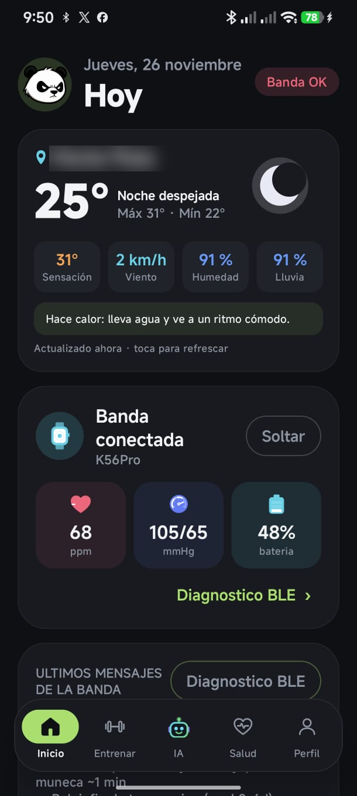
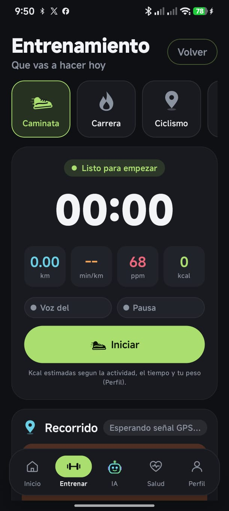
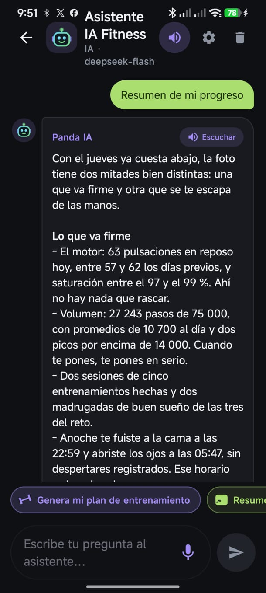
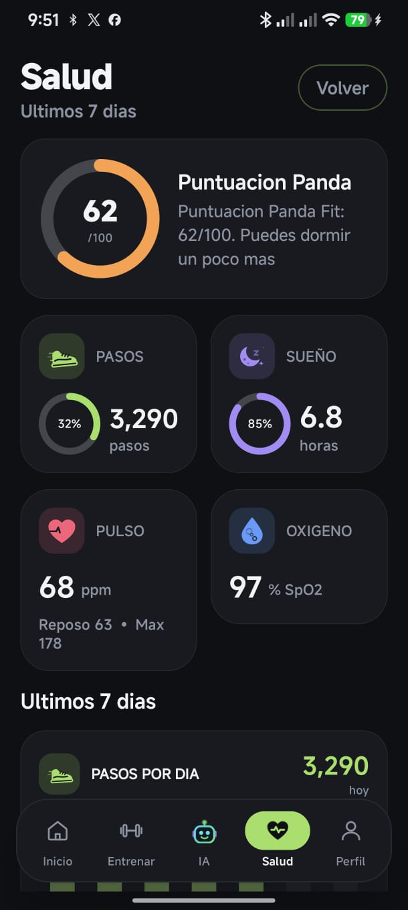
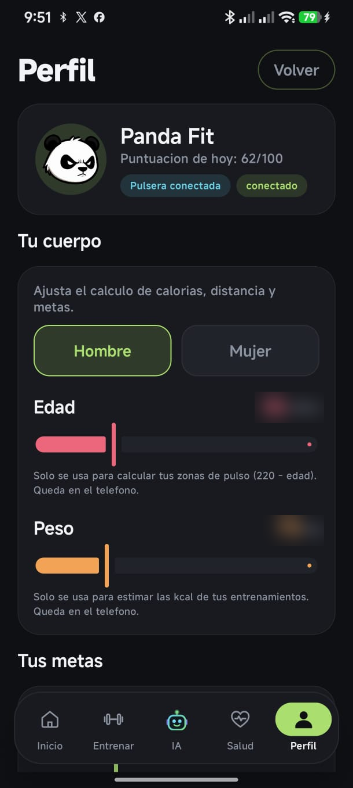
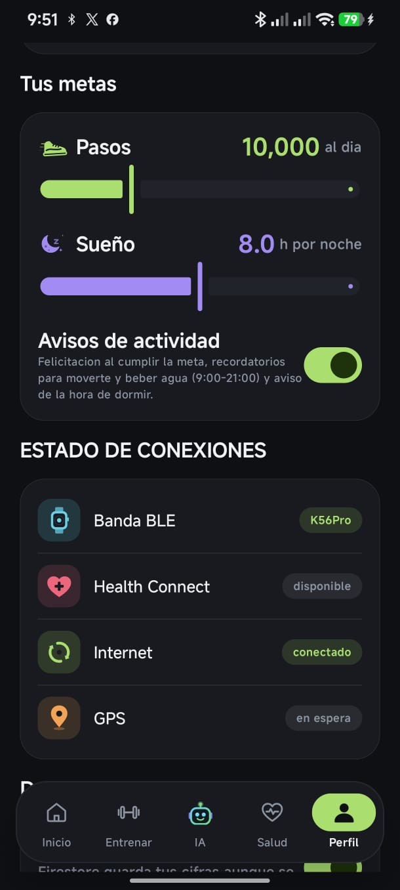
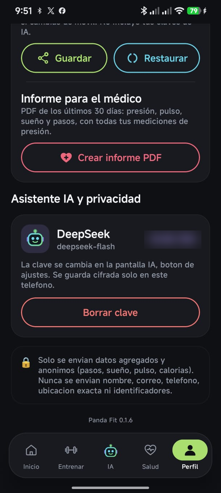

# PandaFit

App de fitness para Android con pulsera inteligente (compatible DaFit / Moyoung) y entrenador personal con IA.

- Pasos, sueño con fases, pulso, presión arterial, SpO2 e hidratación.
- Clima de tu ciudad con consejo para entrenar.
- Entrenamientos con GPS, mapa, voz del entrenador y pausa automática.
- Asistente IA "Panda" (Gemini, OpenAI, DeepSeek o Claude con tu propia clave), con memoria y voz natural.
- Logros, retos semanales, análisis del sueño, informe PDF para el médico, copia de seguridad y Health Connect.

## Capturas

| Inicio | Entrenar | Asistente IA | Salud |
|:---:|:---:|:---:|:---:|
|  |  |  |  |

| Perfil | Metas y conexiones | Tus datos e IA |
|:---:|:---:|:---:|
|  |  |  |

## Descarga
Las versiones (APK) están en **[Releases](../../releases)**.

## Privacidad
Tus datos se guardan en el teléfono. A la IA solo se envían datos agregados y anónimos, y las claves de IA se guardan cifradas en el dispositivo.
